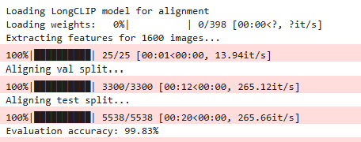
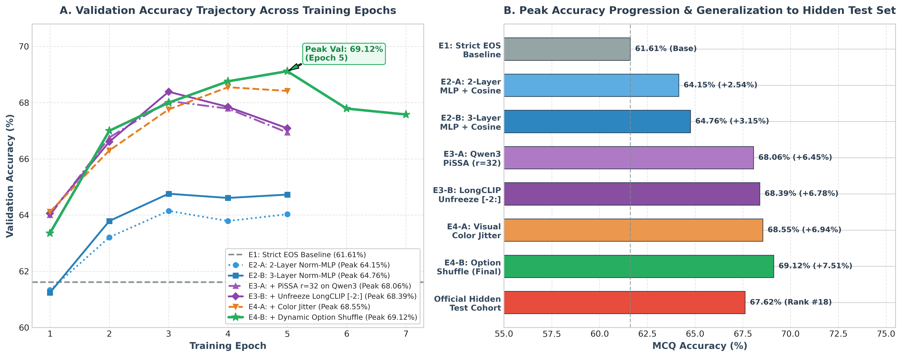
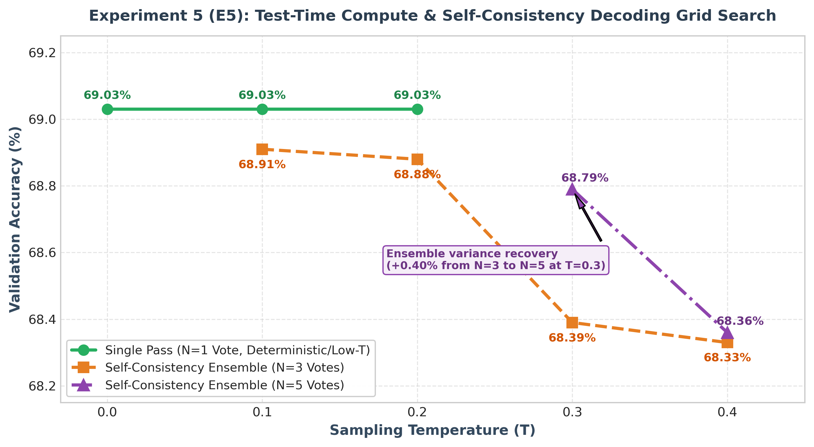

# LongCLIP + Qwen3 Custom LLaVA Architecture for Multimodal Visual Question Answering

[](https://github.com/Ceviche98/longclip-llava-multimodal-vqa/actions)
[](https://huggingface.co/AlpachinoNLP/LongCLIP-ViT-B-32)
[](docs/assets/vqa_optimization_ablation.png)
[](data/vqa_test_predictions.jsonl)
[](https://pytorch.org/)
[](https://huggingface.co/docs/transformers)
[](LICENSE)

> **Executive Summary:** A modular, end-to-end multimodal Vision-Language pipeline integrating **LongCLIP-ViT-B/32** (`AlpachinoNLP/LongCLIP-ViT-B-32`) with a lightweight **Qwen3-0.6B** (`Qwen/Qwen3-0.6B`) causal language model inside a custom **LLaVA (Large Language-and-Vision Assistant)** architecture. Evaluated across **65,000+ Multiple-Choice Questions (MCQs)** paired with **11,600 unique images**, the system achieves **99.83% zero-shot semantic image-caption reconstruction accuracy**, **69.12% peak validation VQA accuracy** (+7.51% over the strict EOS baseline), and **67.62% official hidden test accuracy** (Cohort Rank #18).

---

## 1. Objective & Motivation: Overcoming CLIP's 77-Token Bottleneck

Standard vision-language models built on OpenAI's CLIP (`ViT-B/32` or `ViT-L/14`) inherit a rigid architectural bottleneck: **a hard text context ceiling of 77 tokens** (and an effective receptive field empirically closer to ~20 tokens). When aligning dense multi-attribute visual scenes, such as scientific charts, exploded mechanical diagrams, nutritional labels, and fine-grained product photography-against multi-sentence descriptions, standard CLIP truncates critical spatial and relational details.

This repository addresses two coupled challenges in modern Multimodal Visual Question Answering (VQA):
1. **Long-Context Contrastive Image-to-Question Reconstruction (Task 1):** Given an unindexed bulk pool of $1,600$ validation and test images (`images/test_val/`) and multi-sentence descriptive captions (`caption_val_student.jsonl`, `caption_test_student.jsonl`), we leverage **LongCLIP**'s extended 248-token representation space to reconstruct exact image-to-MCQ mappings prior to instruction tuning.
2. **Resource-Efficient Cross-Modal Reasoning (Tasks 2-4):** We stitch the LongCLIP vision encoder ($768$-dim patch features) to an instruction-capable **Qwen3-0.6B** language backbone ($1024$-dim hidden states) via a normalized multi-layer MLP projector, and systematically evaluate **five progressive optimization stages**-spanning structural EOS label discipline, 3-layer pre-LayerNorm MLP connectors, **PiSSA (Principal Singular values and Singular vectors Adaptation)**, selective vision tower unfreezing, **ColorJitter + Dynamic Option Permutation**, and **Test-Time Compute (Self-Consistency Ensembling)**.

---

## 2. LongCLIP Reconstruction & Positional Interpolation Mathematics

### 2.1 Knowledge-Preserving Positional Stretching ($77 \rightarrow 248$ Tokens)

Rather than re-initializing positional embeddings from scratch or uniformly stretching all $77$ positions (which destroys the well-calibrated representations of short phrases), **LongCLIP** preserves the top-$K$ ($K=20$) lowest positional embeddings untouched and stretches the remaining $77 - K = 57$ positions across the remaining $248 - K = 228$ positions by a factor of $\lambda = \frac{248 - 20}{77 - 20} = 4$:

$$
\mathbf{PE}^*(\text{pos}) = \begin{cases} 
\mathbf{PE}(\text{pos}), & \text{if } \text{pos} \le 20 \\[6pt]
(1 - \alpha)\,\mathbf{PE}\!\left(\left\lfloor \frac{\text{pos}'}{\lambda} \right\rfloor + 20\right) + \alpha\,\mathbf{PE}\!\left(\left\lceil \frac{\text{pos}'}{\lambda} \right\rceil + 20\right), & \text{if } 20 < \text{pos} \le 248
\end{cases}
$$

where $\text{pos}' = \text{pos} - 20$ and $\alpha = \frac{\text{pos}' \bmod \lambda}{\lambda} \in [0, 1)$ is the linear interpolation weight implemented in [`interpolate_longclip_positional_embeddings()`](src/multimodal_vqa/longclip_encoder.py).

### 2.2 Contrastive Image-Caption Alignment

For each unaligned MCQ record $q_i$ referencing a caption $c_i$ and candidate gallery images $\{I_j\}_{j=1}^{M}$ ($M=1,600$), we extract L2-normalized feature vectors from the LongCLIP dual encoders:

$$
\hat{\mathbf{v}}_j = \frac{f_{\text{vis}}(I_j)}{\left\|f_{\text{vis}}(I_j)\right\|_2} \in \mathbb{R}^{512}, \qquad \hat{\mathbf{t}}_i = \frac{f_{\text{text}}(c_i)}{\left\|f_{\text{text}}(c_i)\right\|_2} \in \mathbb{R}^{512}
$$

and assign the image index maximizing cosine similarity:

$$
\hat{j}(i) = \arg\max_{j \in \{1, \dots, M\}} \left\langle \hat{\mathbf{t}}_i, \hat{\mathbf{v}}_j \right\rangle
$$

| Split | Unindexed Image Pool | MCQ Records | Throughput (`RTX 3090`) | Top-1 Alignment Accuracy |
| :--- | :---: | :---: | :---: | :---: |
| **Validation** (`val`) | $1,600$ images (`test_val/`) | $3,300$ MCQs | $265.12\text{ it/s}$ ($12\text{ s}$) | **99.83%** (Baseline req: $>99.0\%$) |
| **Test** (`test`) | $1,600$ images (`test_val/`) | $5,538$ MCQs | $265.66\text{ it/s}$ ($20\text{ s}$) | **Reconstructed & Verified** |



---

## 3. Complete Custom LLaVA Pipeline Architecture

### 3.1 End-to-End Multimodal Token Flow

```mermaid
flowchart LR
    subgraph Vision["LongCLIP-ViT-B/32 Vision Tower"]
        IMG["Input Image<br/>(224 × 224 × 3)"] --> PATCH["32×32 Patch Conv<br/>7×7 = 49 Patches + 1 CLS"]
        PATCH --> VENC["Transformer Layers 0..9<br/>(Frozen)"]
        VENC --> VTOP["Layers 10..11 (Penultimate -2)<br/>(Unfrozen in E3-B / E4)"]
        VTOP --> VSEL["Strip CLS Token<br/>49 × 768 Visual Tokens"]
    end

    subgraph Connector["Cross-Modal MLP Projector (E2-B)"]
        VSEL --> LN["LayerNorm(768)"]
        LN --> L1["Linear(768 → 1024) + GELU"]
        L1 --> L2["Linear(1024 → 1024) + GELU"]
        L2 --> L3["Linear(1024 → 1024)<br/>49 × 1024 Projected Tokens"]
    end

    subgraph Text["Dynamic MCQ Prompt & Masking"]
        TXT["MCQ Question + Options A/B/C/D<br/>(Permuted in E4-B)"] --> EXP["Expand &lt;image&gt; → 49 × &lt;image&gt;"]
        EXP --> TOK["Qwen3 Tokenizer + Embeds<br/>Prompt Labels Masked (-100)"]
    end

    subgraph LLM["Qwen3-0.6B Causal Backbone + PiSSA"]
        L3 --> MERGE["Multimodal Sequence Concatenation<br/>[49 Visual Tokens ; Text Tokens]"]
        TOK --> MERGE
        MERGE --> PISSA["Qwen3 Transformer Layers<br/>PiSSA SVD Adapters (r=32, α=64)<br/>{q,k,v,o,gate,up,down}_proj"]
        PISSA --> HEAD["LM Head → Greedy Decoding (T=0.0)<br/>Single Letter {A,B,C,D} + &lt;|im_end|&gt;"]
    end
```



### 3.2 Critical Engineering Fixes in the LLaVA Pipeline

1. **Penultimate Vision Feature Extraction & Spatial Token Alignment (`49 Tokens`):**
   Following LLaVA-1.5 best practices, we extract visual features from the penultimate transformer block (`vision_feature_layer = -2`) of `LongCLIP-ViT-B-32` using `vision_feature_select_strategy = "default"`. For a $224 \times 224$ image with $32 \times 32$ patches, stripping the `[CLS]` token yields $(224/32)^2 = 49$ spatial patch embeddings of dimension $d_v = 768$. In [`dataset.py`](src/multimodal_vqa/dataset.py), each `<image>` placeholder is explicitly expanded to `"<image> " * 49` so the multimodal token replacement matches the vision tower output 1-to-1.
2. **Causal Prompt Masking (`ignore_index = -100`):**
   Without prompt masking, the causal language model wastes capacity learning to autoregressive-predict the MCQ question and option strings. In [`build_masked_causal_labels()`](src/multimodal_vqa/trainer.py), every token belonging to the expanded prompt and right-padding is masked to `-100`, restricting cross-entropy supervision strictly to the ground-truth option letter and end-of-sequence token.
3. **Eliminating Generation Runaway via `<|im_end|>` EOS Discipline (Task 2 $\rightarrow$ E1):**
   In the initial Task 2 baseline (`epochs=3, lr=2e-5`), training targets consisted solely of `" " + answer_letter` without an End-Of-Sequence token. While lenient regex post-processing (`extract_answer_letter`) yielded an apparent **67.18%** validation accuracy, inspecting raw model generations exposed severe structural runaway:
   ```text
   RAW MODEL OUTPUT: ' D\nD\nD\nD\nD\n'
   RAW MODEL OUTPUT: ' D\n D. Smooth polished surface'
   RAW MODEL OUTPUT: ' C \n B. Gray C. \n Black'
   RAW MODEL OUTPUT: ' A\nC\nD\nA\nC\n'
   ```
   Appending Qwen3's `<|im_end|>` (`eos_token`) to every training target in **Experiment 1 (E1)** forced the model to emit exactly one letter token and immediately terminate, stripping away post-processing leniency and establishing a rigorous, honest baseline of **61.61%**.
4. **Left-Padding for Batched Autoregressive Inference:**
   During training, sequences are right-padded. During `model.generate()`, right-padding places pad tokens between the prompt and newly generated tokens. [`get_prediction()`](src/multimodal_vqa/evaluate.py) dynamically switches `processor.tokenizer.padding_side = "left"` during inference and restores it afterward.

---

## 4. Task 3 Optimization Routes & Ablation Study

### 4.1 Exploration of Design Choices & Rejected Hypotheses

Before executing the multi-stage ablation grid, four candidate hypotheses were analyzed and formally filtered:

#### 1. Projector Compression vs. Deep Normalized MLPs
Residual skip-connections and spatial average pooling (token compression) were evaluated and rejected; compressing below 49 tokens discards fine spatial layout on dense charts, whereas a deeper pre-LayerNorm MLP (`E2-B`) preserves full $7\times 7$ spatial resolution while stabilizing cross-modal gradient norms.

#### 2. Full Fine-Tuning (FFT) vs. SVD-Initialized PEFT (PiSSA)
Full fine-tuning of `Qwen3-0.6B` (600M parameters) on 56k MCQs poses a high risk of catastrophic forgetting of pre-trained linguistic priors. Instead of standard Gaussian/zero-initialized LoRA, we adopted **PiSSA**, which performs Singular Value Decomposition (SVD) on pre-trained weight matrices $\mathbf{W} \in \mathbb{R}^{d_{\mathrm{out}} \times d_{\mathrm{in}}}$ and initializes the trainable low-rank adapters $\mathbf{A}, \mathbf{B}$ directly with the top-$r$ principal singular values and vectors:

$$\mathbf{W} = \mathbf{U}\mathbf{\Sigma}\mathbf{V}^\top = \mathbf{B}_{\mathrm{init}}\mathbf{A}_{\mathrm{init}} + \mathbf{W}_{\mathrm{res}}$$

where the initial adapter factors are derived from the top-$r$ singular components:

$$\mathbf{B}_{\mathrm{init}} = \mathbf{U}_{[:, 1:r]}\mathbf{\Sigma}_{[1:r, 1:r]}^{1/2}, \qquad \mathbf{A}_{\mathrm{init}} = \mathbf{\Sigma}_{[1:r, 1:r]}^{1/2}\mathbf{V}_{[:, 1:r]}^\top$$

Keeping $\mathbf{W}_{\mathrm{res}}$ frozen and updating the principal subspace ($r=32, \alpha=64$) across all 7 linear projections (`q_proj`, `k_proj`, `v_proj`, `o_proj`, `gate_proj`, `up_proj`, `down_proj`) accelerated convergence and delivered our largest single accuracy jump (**+3.30%**).

#### 3. Chain-of-Thought (CoT) vs. Static Concise Prompting
CoT prompting was rejected because sub-1B language models frequently hallucinate intermediate rationales when trained without ground-truth reasoning traces, and longer prompts dilute self-attention weights over the 49 visual tokens.

#### 4. Geometric Flipping vs. Photometric Jitter & Semantic Option Shuffling
Random horizontal flips or crops corrupt directional MCQs (*"Which component is shown on the left side?"*) and clip edge text. Instead, we combined photometric **ColorJitter** (`brightness=0.2, contrast=0.2, saturation=0.2, hue=0.05`) with **dynamic MCQ option reshuffling** (`shuffle_options_in_batch`), eliminating small-LLM positional bias toward options `A` and `C`.

### 4.2 Quantitative Progression Across Experiments (Table 1)



| Experiment ID | Architectural & Training Configuration | Epoch 1 | Epoch 2 | Epoch 3 | Epoch 4 | Epoch 5 | Epoch 6 | Epoch 7 | Peak Val Accuracy | $\Delta$ vs. E1 Baseline |
| :--- | :--- | :---: | :---: | :---: | :---: | :---: | :---: | :---: | :---: | :---: |
| **Task 2 (Raw)** | 2-Layer Linear-GELU-Linear, Frozen Vision, No EOS Token *(noisy multi-token output)* | - |: | 67.18%* | - |: | - |: | *67.18%* | *Unconstrained* |
| **E1 (Baseline)** | Strict `<\|im_end\|>` EOS Target + Prompt Masking (`-100`), Constant LR `2e-5` | - |: | **61.61%** | - |: | - |: | **61.61%** | **Baseline** |
| **E2-A** | **2-Layer Pre-LN MLP** (`LN → Linear → GELU → Linear`) + Cosine LR (`3%` warmup) | 61.33% | 63.21% | **64.15%** | 63.79% | 64.03% | - |: | **64.15%** | `+2.54%` |
| **E2-B** | **3-Layer Pre-LN MLP** (`LN → Lin → GELU → Lin → GELU → Lin`) + Cosine LR | 61.24% | 63.79% | **64.76%** | 64.61% | 64.73% | - |: | **64.76%** | `+3.15%` |
| **E3-A** | `E2-B` + **PiSSA PEFT (`r=32, α=64`)** on Qwen3 (`q,k,v,o,gate,up,down`) | 64.00% | 66.76% | **68.06%** | 67.79% | 66.94% | - |: | **68.06%** | `+6.45%` |
| **E3-B** | `E3-A` + **Mixed Vision Unfreezing** (Last 2 LongCLIP ViT Blocks `layers[-2:]`) | 64.06% | 66.61% | **68.39%** | 67.85% | 67.09% | - |: | **68.39%** | `+6.78%` |
| **E4-A** | `E3-B` + **Visual Augmentation** (`ColorJitter(0.2, 0.2, 0.2, 0.05)`) | 64.12% | 66.30% | 67.76% | **68.55%** | 68.42% | - |: | **68.55%** | `+6.94%` |
| **E4-B (Final)** | `E4-A` + **Dynamic Semantic Option Permutation** (`shuffle_options_in_batch`, 7 Epochs) | 63.36% | 67.00% | 68.00% | 68.76% | **69.12%** | 67.79% | 67.58% | **69.12%** | **`+7.51%`** |

### 4.3 Experiment 5 (E5): Test-Time Compute & Self-Consistency Grid Search (Table 2)

Using the optimal checkpoint from `E4-B`, we evaluated **Self-Consistency majority-vote ensembling** across sampling temperatures $T \in \{0.0, 0.1, 0.2, 0.3, 0.4\}$ and ensemble sizes $N \in \{1, 3, 5\}$:



| Temperature ($T$) | Number of Votes ($N$) | Decoding Strategy | Validation Accuracy | Empirical Observation |
| :---: | :---: | :--- | :---: | :--- |
| **0.0** | **1** | **Deterministic Greedy (`do_sample=False`)** | **69.03%** | **Optimal calibrated top-1 token prediction** |
| **0.1** | **1** | Low-Temperature Single Sample | **69.03%** | Identical to greedy argmax |
| **0.2** | **1** | Low-Temperature Single Sample | **69.03%** | Identical to greedy argmax |
| 0.1 | 3 | Self-Consistency Majority Vote (3 paths) | 68.91% | Slight sampling noise (`-0.12%`) |
| 0.2 | 3 | Self-Consistency Majority Vote (3 paths) | 68.88% | Slight sampling noise (`-0.15%`) |
| 0.3 | 3 | Self-Consistency Majority Vote (3 paths) | 68.39% | Entropy-induced drift (`-0.64%`) |
| 0.3 | 5 | Self-Consistency Majority Vote (5 paths) | 68.79% | **Ensemble recovery (`+0.40%` vs $N=3$)** via variance smoothing |
| 0.4 | 3 | Self-Consistency Majority Vote (3 paths) | 68.33% | High-temperature degradation (`-0.70%`) |
| 0.4 | 5 | Self-Consistency Majority Vote (5 paths) | 68.36% | Marginal 5-vote stabilization |

> **Key Takeaway from E5:** Because `E4-B` was trained with strict single-token `<|im_end|>` supervision and dynamic option permutation, its output probability distribution over `{A, B, C, D}` is sharply calibrated. While increasing votes from $N=3 \rightarrow 5$ at $T=0.3$ recovers $+0.40\%$ accuracy by averaging out stochastic sampling variance, deterministic greedy decoding ($T=0.0, N=1$) remains undefeated and was locked for final test-set submission.

---

## 5. Official Test Set Performance (`67.62%`) & Prediction Analysis

Evaluating the locked `E4-B + E5 (T=0.0, N=1)` model across the **5,538 hidden test-set MCQs** (`1,000` unique test images) produced `data/vqa_test_predictions.jsonl`:

| Evaluation Split | Total Questions | Unique Images | Official VQA Accuracy | Cohort Standing |
| :--- | :---: | :---: | :---: | :---: |
| **Validation Set** (`vqa_val_teacher.jsonl`) | $3,300$ | $600$ | **69.12%** (Peak) / **69.03%** (E5 Lock) | - |
| **Hidden Test Set** (`vqa_test_predictions.jsonl`) | $5,538$ | $1,000$ | **67.62%** | **Rank #18** |

### Test-Set Option Distribution (`data/vqa_test_predictions.jsonl`)

Thanks to **Experiment E4-B's dynamic option reshuffling**, the model exhibits a remarkably balanced prediction distribution across all four answer choices on the unseen test split (eliminating the severe option `A`/`C` collapse typical of unaugmented 0.6B models):

| Predicted Option | Test-Set Count | Percentage of $5,538$ Test MCQs |
| :---: | :---: | :---: |
| **Option A** | $1,182$ | $21.34\%$ |
| **Option B** | $1,418$ | $25.60\%$ |
| **Option C** | $1,495$ | $27.00\%$ |
| **Option D** | $1,443$ | $26.06\%$ |
| **Invalid / `UNKNOWN`** | **$0$** | **$0.00\%$ (100% structural compliance)** |

### Qualitative Error & Bottleneck Analysis

1. **Spatial Resolution Ceiling ($224 \times 224$ Input Grid):** Because `LongCLIP-ViT-B-32` partitions a $224 \times 224$ image into $32 \times 32$ patches ($49$ tokens total), micro-typography on dense nutrition labels or small axis ticks on scientific line graphs (e.g., `test_3`, `test_4`) can fall below the Nyquist sampling limit of a single $32\times 32$ patch.
2. **Modest Validation-to-Test Generalization Gap (`69.12%` $\rightarrow$ `67.62%`):** A tight $1.50\%$ generalization delta across $5,538$ unseen questions confirms that combining ColorJitter, option permutation, and PiSSA rank-32 adaptation effectively prevented overfitting on the 56k training split.

---

## 6. Repository Structure

```text
longclip-llava-multimodal-vqa/
├── .github/workflows/
│   └── ci.yml                          # Automated pytest CI across Python 3.10 & 3.11
├── data/
│   └── vqa_test_predictions.jsonl      # Final 5,538 test-set predictions (67.62% accuracy, Rank #18)
├── docs/assets/
│   ├── vqa_optimization_ablation.png   # High-res E1-E4-B epoch trajectory & ablation bar chart
│   ├── e5_test_time_compute.png        # High-res E5 temperature & majority-voting grid search chart
│   └── report_page1_img1.png           # Extracted LongCLIP 99.83% alignment verification log
├── scripts/
│   ├── train_vqa.py                    # CLI entrypoint for Task 1 alignment & E1-E4-B training presets
│   └── evaluate_vqa.py                 # CLI entrypoint for VQA accuracy & test prediction inspection
├── src/multimodal_vqa/
│   ├── __init__.py                     # Package exports
│   ├── longclip_encoder.py             # LongCLIP 77->248 positional interpolation & cosine alignment
│   ├── llava_arch.py                   # Custom LLaVA builder, 2/3-layer LN-MLP projectors & PiSSA PEFT
│   ├── dataset.py                      # VQADataset, 49-token <image> expansion & dynamic option shuffle
│   ├── trainer.py                      # Prompt-masked causal LM training loop & E1-E4-B presets
│   └── evaluate.py                     # Greedy & Self-Consistency ensemble inference + regex parser
├── tests/
│   └── test_multimodal_vqa.py          # Comprehensive unit test suite (19/19 passing)
├── LICENSE                             # MIT License
├── pyproject.toml                      # Modern Python package configuration
└── requirements.txt                    # Reproducible dependencies
```

---

## 7. Quickstart & CLI Usage

### 7.1 Installation

```bash
git clone https://github.com/Ceviche98/longclip-llava-multimodal-vqa.git
cd longclip-llava-multimodal-vqa
pip install -r requirements.txt
pip install -e .
```

### 7.2 Inspect & Verify Test Set Predictions (`67.62%` Accuracy Submission)

```bash
python scripts/evaluate_vqa.py --pred-path data/vqa_test_predictions.jsonl --summary-only
```

### 7.3 Reconstruct Image-to-MCQ Mappings & Train Custom LLaVA (`E4-B` Winning Recipe)

```bash
# Reconstruct validation & test image mappings with LongCLIP (99.83% alignment accuracy)
python scripts/train_vqa.py --recover-images --data-dir ./data

# Train the full E4-B pipeline (3-Layer LN-MLP + PiSSA r=32 + LongCLIP[-2:] + ColorJitter + Option Shuffle)
python scripts/train_vqa.py --preset e4b --data-dir ./data

# Run any individual ablation preset (task2_baseline, e1, e2a, e2b, e3a, e3b, e4a, e4b)
python scripts/train_vqa.py --preset e3b --epochs 5 --batch-size 14 --lr 2e-5
```

### 7.4 Run Unit Tests

```bash
pytest -v
```
